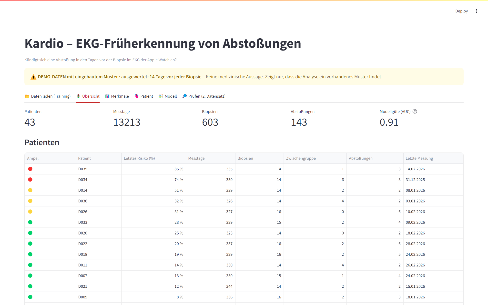
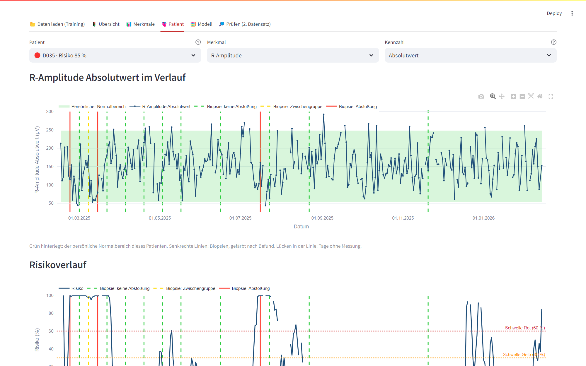

# Kardio – EKG-Früherkennung von Abstoßungen nach Herztransplantation

Hackathon-Prototyp. Zwei Tabellen hochladen (EKG-Messungen der Apple Watch und Biopsiebefunde),
auf „Analysieren“ klicken, und das Werkzeug prüft, ob sich das EKG in den 14 Tagen vor einer
Biopsie mit Abstoßung anders verhält als vor einer Biopsie ohne Abstoßung.

> **Wichtig:** Heute gibt es keine echte Biopsietabelle. Die mitgelieferte Demo erzeugt
> künstliche Patienten mit einem absichtlich eingebauten Muster. Sie zeigt, dass die Analyse ein
> vorhandenes Muster findet und ohne Muster nichts findet. Sie ist **keine medizinische Aussage**.

## Screenshots





## Starten

**Auf dem eigenen Rechner (Windows):** Doppelklick auf `start.bat`. Beim ersten Mal werden die
benötigten Pakete installiert, danach öffnet sich das Dashboard im Browser.

**Ohne Dashboard (Kommandozeile):**

```bash
.venv/Scripts/python -m kardio.run --demo               # Demo mit eingebautem Muster
.venv/Scripts/python -m kardio.run --demo --no-pattern  # Demo ohne Muster
.venv/Scripts/python -m kardio.run --ecg ekg.csv --biopsies biopsien.csv
```

**Tests:** `.venv/Scripts/python -m pytest -q`

## Training und Prüfung

- **Reiter »Daten laden (Training)«:** Aus einem Datensatz mit Biopsiebefunden lernt das Modell seine Gewichte.
- **Reiter »Prüfen (2. Datensatz)«:** Die Gewichte bleiben eingefroren. Ein zweiter Datensatz mit anderen
  Patienten wird nur bewertet. Mit Biopsietabelle zeigt der Reiter, ob Alarm und Befund übereinstimmen;
  ohne Biopsietabelle liefert er nur die Risikowerte (der spätere Alltagseinsatz).

## Was die Tabellen enthalten müssen

| Tabelle | Inhalt |
|---|---|
| EKG | Spalten `Name` (Patientenkürzel), `Date` (Dateiname mit Datum, z. B. `ecg_2025-08-28_1.csv`), `included_no`, `cc` und je Merkmal `_mean`, `_sd`, `_min`, `_max` |
| Biopsien | Patientenkürzel, Biopsienummer (optional), Datum, Befund. Spaltennamen und Schreibweisen dürfen abweichen (Deutsch/Englisch, `ja/nein`, `0/1/2`, `0R–3R`, „Zwischengruppe“). Nicht erkannte Spalten lassen sich im Dashboard von Hand zuordnen. |

Verknüpft wird über das Patientenkürzel. Gibt es mehrere Messungen an einem Tag, bleibt die
vollständigste (wenigste leere Felder, dann meiste verwertete Herzschläge).

## Wie die Auswertung arbeitet

1. **Einlesen und Bereinigen** – eine Messung pro Patient und Tag, Lücken bleiben Lücken.
2. **Persönliche Normallinie** – je Patient und Merkmal aus seinen stabilen Tagen; jede Messung
   wird als Abweichung davon ausgedrückt. Drei Kennzahlen wie in der bisherigen Prism-Auswertung:
   Absolutwert, CV (Unruhe), Abweichung.
3. **Fenster vor jeder Biopsie** – die 14 Tage davor werden je Merkmal verdichtet.
4. **Statistik** – Kruskal-Wallis und paarweise Mann-Whitney-U über die drei Befundgruppen,
   korrigiert für Mehrfachtests.
5. **Risikomodell** – einfache, erklärbare logistische Regression, geprüft an Patienten, die das
   Modell nicht gesehen hat. Bei zu wenig Daten gibt es bewusst keine Risikozahl.
6. **Befundtext** – ein Sprachmodell formuliert die berechneten Zahlen aus. Es sucht selbst keine
   Muster; jede Zahl im Text wird gegen die Berechnung geprüft, sonst erscheint ein Vorlagentext.

Alle Stellschrauben stehen in `config/analysis.yaml` (Auswertung) und `config/generator.yaml` (Demo).

## Online stellen (Render)

1. Auf render.com anmelden → **New** → **Blueprint** → dieses Repo wählen. Render liest `render.yaml`.
2. Zwei Werte eintragen: `MGA_API_KEY` (Schlüssel für den Befundtext) und `APP_PASSWORD`
   (Kennwort für den Zugang zum Dashboard).
3. **Apply**. Die Webadresse steht danach auf der Service-Seite.

Ohne `MGA_API_KEY` läuft alles, der Befundtext kommt dann aus der Vorlage.
Im kostenlosen Paket schläft die Seite nach 15 Minuten ein; der erste Aufruf danach dauert rund eine Minute.

## Daten und Schlüssel

- Echte Patientendaten (`data/raw/`) und Schlüssel (`.env`) liegen nur lokal und sind von Git ausgeschlossen.
- Die Demo nutzt `config/reference_stats.json`: reine Durchschnittswerte, keine Einzelmessungen.

## Grenzen

- Demo-Daten sind erfunden. Belastbar wird die Auswertung erst mit der echten Biopsietabelle.
- Mehrere Biopsien desselben Patienten sind nicht unabhängig voneinander; die p-Werte sind deshalb
  eher zu optimistisch.
- Die Auswertung ist rückblickend und ersetzt weder Biopsie noch ärztliche Beurteilung.

Spezifikation: `docs/superpowers/specs/2026-10-10-ekg-abstossung-design.md`
Übergabe und Zusammenfassung: `docs/UEBERGABE.md`
